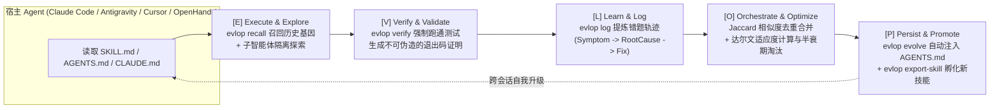

# EVLOP: Universal Self-Evolving Agent Framework

<p align="center">
  <b>从 Claude 5.2 / 5.5 顶级工程实践与 2023–2026 自进化顶会论文中提炼的通用 AI Agent 自进化框架</b><br>
  <i>Execute & Explore · Verify & Validate · Learn & Log · Orchestrate & Optimize · Persist & Promote</i>
</p>

<p align="center">
  <a href="./README_EN.md">English Documentation (README_EN.md)</a> ·
  <a href="./docs/why-claude-is-strong.md">为什么 Claude 这么强？</a> ·
  <a href="./docs/evlop-methodology.md">EVLOP 方法论规范</a> ·
  <a href="./docs/cross-agent-verification-report.md">跨 Agent 真实盲测报告</a> ·
  <a href="./docs/papers-and-ecosystem.md">顶会论文与开源全景索引</a>
</p>

---

## 一、 为什么要做 EVLOP？

在 GitHub 和真实软件工程中，Anthropic 的最新旗舰模型（**Claude Fable 5.2 / Mythos 5.2** 与 **Claude Opus 5.5 / Sonnet 5.5**）配合 **Claude Code** 展现出了统治级的表现（SWE-bench Verified 解决率突破 80%+）。

深入拆解其底层架构（参见 [docs/why-claude-is-strong.md](./docs/why-claude-is-strong.md)）可以发现，Claude 强大的核心秘密在于：
1. **Execution-Guided RL（真实容器执行闭环）**：每次修改必须经过真实测试报错与验证反馈。
2. **Model-Harness Co-design（模型与专用工具协同）**：通过高内聚工具与子智能体（Subagent）隔离探索噪音。
3. **Context Governance（上下文治理）**：通过 `CLAUDE.md` 与 `SKILL.md` 按需挂载领域规范，抵抗长上下文腐烂（Context Rot）。

然而，现有的大多数 AI Agent 依然面临**“跨会话失忆（Cross-Session Amnesia）”**与**“记忆库膨胀腐烂（Context Rot）”**两大痛点。
**EVLOP** 将 Claude 的工程精髓与 **TMLR 2026 自进化综述 (`arXiv:2507.21046`)、`Reflexion`、`Voyager`、`TextGrad`、`ADAS`、`SWE-agent`** 以及 GitHub 头部开源项目（`claude-evolve`、`EvoMap`、`Self-Evolving-Skill`）深度融合，打造出一套**零第三方依赖、任何 AI Agent 都能直接挂载实现跨会话自进化**的双层框架。

---

## 二、 EVLOP 五步自进化架构



### 达尔文适应度评分公式（Darwinian Fitness Formula）

为了确保只有**真正经过真实命令验证、高频复用且未过时**的黄金经验才能进入 Agent 的主提示词，EVLOP 引擎内置如下适应度方程：

$$\text{Fitness}(g) = \underbrace{\frac{S + 1}{S + F + 2}}_{\text{拉普拉斯平滑成功率}} \times \underbrace{\left(1 + 0.5 \cdot \ln(1 + S)\right)}_{\text{经验频次增益}} \times \underbrace{V_{\text{bonus}}}_{\text{确定性验证乘子}} \times \underbrace{2^{-\Delta t / H}}_{\text{时间半衰期衰减}}$$

- **防奖励黑客（Anti-Reward-Hacking）**：若未通过 `evlop verify`（即 `verified_gate == False`），该基因永远无法晋升（`promoted`）进入 `AGENTS.md` / `CLAUDE.md`。
- **防上下文腐烂（Anti-Context-Rot）**：近义规则（Jaccard 相似度 $\ge 0.65$）自动合并；陈旧低分规则自动归档（`archived`）；注入主文档的规则严格限制在 Top 15 以内。

---

## 三、 30 秒快速开始（供人类开发者与 AI Agent 使用）

`evlop` 核心引擎仅使用 **Python 3.10+ 标准库**实现，无需安装任何第三方依赖，可在任何受限沙盒中直接运行。

### 1. 安装或直接运行

```bash
# 方式一：本地可编辑安装（生成全局 evlop 命令）
pip install -e .

# 方式二：零安装直接通过 PYTHONPATH 运行
PYTHONPATH=src python -m evlop status
```

### 2. 完整五步自进化命令流演示

```bash
# Step 0: 在任意项目根目录初始化 .evlop/ 进化记忆库
python -m evlop init

# Step 1 [E - Explore]: 动手前检索相关历史基因
python -m evlop recall "UnicodeDecodeError"

# Step 2 [V - Verify]: 运行测试门禁，生成确定性验证凭证 (.evlop/last_verify.json)
python -m evlop verify "python -m unittest discover -s tests -v"

# Step 3 [L - Learn]: 记录从报错到修复的经验基因 (自动关联上一步的验证凭证)
python -m evlop log \
  --title "Explicit UTF-8 Encoding on Cross-Platform File I/O" \
  --category "debugging" \
  --task "Fix Windows locale encoding crashes" \
  --symptom "UnicodeDecodeError (cp936/gbk) when reading Markdown/JSONL files" \
  --root-cause "Path.read_text() defaults to OS locale encoding when encoding is omitted" \
  --fix "Explicitly pass encoding='utf-8' to all file and subprocess I/O calls" \
  --trigger "Reading/writing files or capturing subprocess output across Windows/Linux" \
  --strategy "Always specify encoding='utf-8' in Path.read_text, Path.write_text, open(), and subprocess.run()" \
  --anti-pattern "Calling Path.read_text() without explicit encoding"

# Step 4 & 5 [O & P - Optimize & Promote]: 去重、计算适应度，并将高分基因编译进 AGENTS.md 与 CLAUDE.md
python -m evlop evolve --target AGENTS.md,CLAUDE.md

# Step 5+ [P - Voyager Skill & Tool Synthesis]: 将高适应度基因导出为独立 SKILL.md 并自动合成可执行脚本 scripts/run_strategy.py
python -m evlop export-skill --gene-id gene-explicit-utf-8-encoding-on-cross-platform --out-dir skills --synthesize-script

# Step 6 [DGM Mode - Phylogenetic Mutation & Lineage Tree]: 基于父代基因派生下一代变异并输出进化谱系树
python -m evlop mutate \
  --parent-id gene-execution-verified-patching-gate \
  --title "Latency-Profiled Execution Verification Gate" \
  --strategy "Run `python -m evlop verify \"python -m unittest discover -s tests -v\"` to capture both exit_code==0 and duration_ms" \
  --reason "AlphaEvolve multi-metric latency profiling upgrade" \
  --agent-id "architect-agent-1"

python -m evlop lineage --mermaid --out docs/LINEAGE.md
```

### 3. 让任何其他 Agent 一键零依赖接入 EVLOP（工程级全自动引导）

- **方式 A：跨项目一键全量引导（推荐 — 零依赖免安装）**
  在任意目标项目上运行一行命令：
  ```bash
  python -m evlop init --target-dir /path/to/your-project --bootstrap --with-hooks
  ```
  该命令会自动在目标项目中生成：
  1. `.evlop/evlop_runner.py`（内嵌完整引擎副本，目标项目无需 `pip install` 或配置 `PYTHONPATH` 即可直接运行 `python .evlop/evlop_runner.py ...`）
  2. `AGENTS.md`、`CLAUDE.md`、`.cursorrules`（预置五步协议与自动进化的 `<!-- EVLOP:START -->` 基因块）
  3. `.claude/settings.json`（会话启动与结束自动触发 `evlop evolve` 的生命周期钩子）
- **方式 B：原生 MCP Server 接入（JSON-RPC 2.0 over stdio）**
  支持 Claude Desktop、Claude Code、Antigravity、Cursor 直接作为 MCP Server 挂载（提供 `evlop_recall`、`evlop_verify`、`evlop_log`、`evlop_evolve`、`evlop_status` 五大原生工具）：
  ```json
  {
    "mcpServers": {
      "evlop": {
        "command": "python",
        "args": ["-m", "evlop", "mcp"]
      }
    }
  }
  ```
- **方式 C：报错即召回（Auto-Recall on Verify Failure）**
  当 Agent 运行 `evlop verify` 测试失败时，引擎会自动解析报错栈提取异常类型（写入 `.evlop/last_failure.json`），并实时检索基因库在终端打印 `[EVLOP Auto-Recall Hint]`；修复后运行 `evlop log --from-last-failure` 即可自动关联报错上下文。实测双智能体盲测报告见 👉 **[docs/cross-agent-verification-report.md](./docs/cross-agent-verification-report.md)**。

---

## 四、 理论底座：顶会论文与开源项目映射表

详细文献综述请查阅 👉 **[docs/papers-and-ecosystem.md](./docs/papers-and-ecosystem.md)**。

| EVLOP 阶段 | 核心机制 | 对应顶会论文 (2023–2026) | 对应顶级开源项目 |
| :--- | :--- | :--- | :--- |
| **[E] Execute & Explore** | ACI 沙盒交互与子智能体上下文隔离 | • **SWE-agent** (*NeurIPS 2024*, `arXiv:2405.15793`)<br>• **TMLR Survey** (*Gao et al., 2026*, `arXiv:2507.21046`) | • `anthropics/claude-code`<br>• `VILA-Lab/Dive-into-Claude-Code` |
| **[V] Verify & Validate** | 确定性测试执行门禁（防幻觉与奖励黑客） | • **Lifelong Agentic Survey** (*Fang et al., 2025*, `arXiv:2508.07407`) | • `mickeyyaya/evolve-loop`<br>• `evanklem/evanflow` |
| **[L] Learn & Log** | 语言强化学习（Verbal RL）与错题轨迹结晶 | • **Reflexion** (*NeurIPS 2023*, `arXiv:2303.11366`)<br>• **TextGrad** (*Nature 2025*, `arXiv:2406.07496`) | • `EvoMap/evolver-claude-code-mods`<br>• `coleam00/claude-memory-compiler` |
| **[O] Orchestrate & Optimize** | 分层记忆治理（合并/评分/半衰期淘汰） | • **Modern Self-Improvements** (*Ren et al., 2026*, `arXiv:2607.13104`) | • `jack60810/claude-evolve`<br>• `ethanbytes/Self-Evolving-Skill` |
| **[P] Persist & Promote** | 规则自动编译与可执行技能库（Skill Library）孵化 | • **Voyager** (*Wang et al., 2023*, `arXiv:2305.16291`)<br>• **ADAS** (*ICLR 2025*, `arXiv:2408.08435`) | • `Piebald-AI/claude-code-system-prompts`<br>• `CharlesQ9/Self-Evolving-Agents` |

---

## 五、 仓库目录结构

```text
evlop/
├── README.md                          # 中文主文档
├── README_EN.md                       # 英文主文档
├── SKILL.md                           # 跨平台 Agent 自进化技能定义 (含 YAML Frontmatter)
├── AGENTS.md                          # 通用 Agent 规范 (内含实时编译的 EVLOP 基因块)
├── CLAUDE.md                          # Claude Code 专属规范与基因块
├── pyproject.toml                     # Python 标准打包配置 (零第三方依赖)
├── docs/
│   ├── why-claude-is-strong.md        # 深度解析：Claude 5.2/5.5 为什么这么强
│   ├── evlop-methodology.md           # EVLOP 五步法与数学模型完整规范
│   └── papers-and-ecosystem.md        # 2023-2026 自进化 Agent 论文与开源项目全景索引
├── templates/                         # 一键复制到其他仓库的接入模板与 Hooks 配置
├── skills/                            # 由 evlop export-skill 自动孵化生成的子技能目录
├── src/evlop/                         # 零依赖 Python 进化引擎源码
└── tests/                             # 完整单元与端到端集成测试套件
```

## 六、 运行测试

```bash
PYTHONPATH=src python -m unittest discover -s tests -v
```

## License

[MIT License](./LICENSE)
